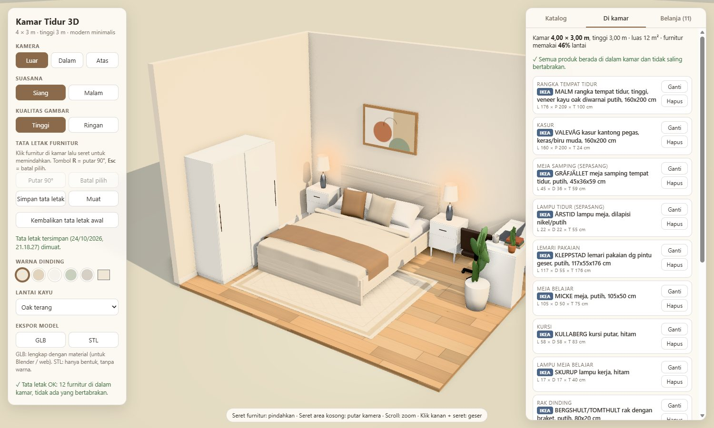
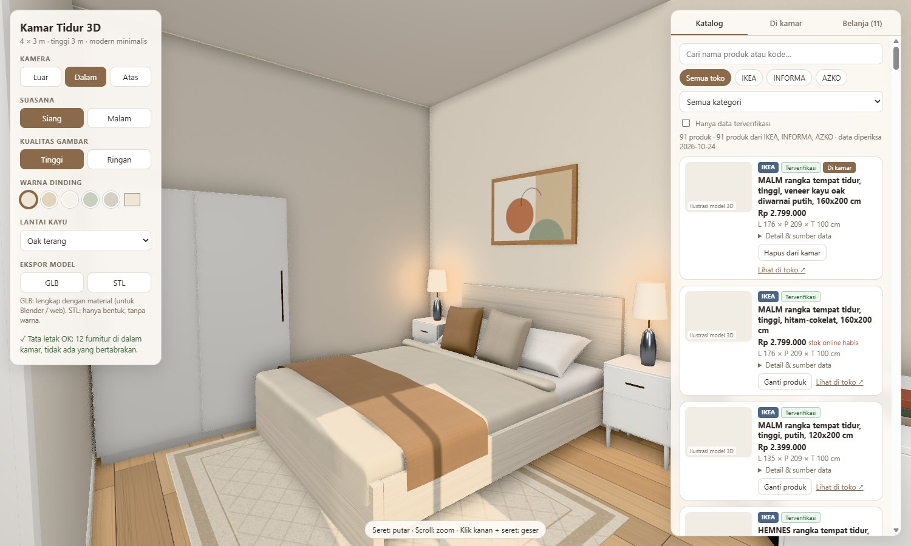
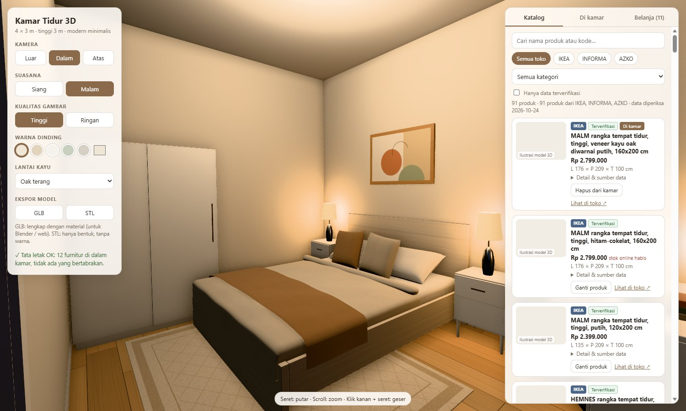
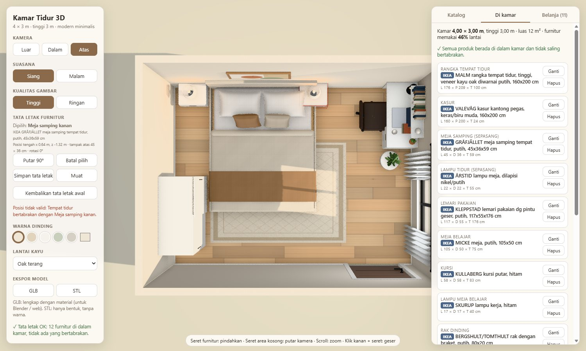

# Desain Kamar Tidur 3D

Desain kamar tidur 3D interaktif yang dibuat sepenuhnya lewat kode dengan **Three.js**. Kamar berukuran **4 × 3 m dengan tinggi 3 m** diisi furnitur dari produk yang dijual di **IKEA Indonesia, INFORMA, dan AZKO**. Furnitur bisa diganti dari katalog, digeser dan diputar langsung di ruang 3D, lalu disusun menjadi daftar belanja dengan estimasi harga.



| Tampak dalam (siang) | Mode malam |
| --- | --- |
|  |  |

## Fitur

**Tampilan 3D**
- Kamera **Luar**, **Dalam**, dan **Atas**. Bisa diputar, di-zoom, dan digeser dengan mouse.
- Mode **Siang** (sinar matahari dan cahaya jendela) dan **Malam** (lampu plafon, lampu tidur, dan lampu meja menyala).
- Material bertekstur yang dibuat lewat kode: lantai kayu, cat dinding, kain, kayu furnitur, kaca jendela, dan karpet.
- Ambient occlusion dan bayangan, dengan pilihan kualitas **Tinggi** atau **Ringan** untuk laptop dengan grafis lemah.
- Dinding yang menghalangi kamera disembunyikan otomatis, sehingga kamar terlihat seperti rumah boneka saat dilihat dari luar.
- Warna dinding dan jenis kayu lantai bisa diganti.

**Katalog produk nyata**
- 91 produk dari IKEA, INFORMA, dan AZKO: rangka tempat tidur, kasur, lemari, meja samping, meja belajar, kursi, lampu, rak dinding, karpet, dan tirai.
- Filter per toko dan kategori, pencarian nama atau kode produk, serta tautan ke halaman produk resmi.
- Setiap produk punya status data: **Terverifikasi**, **Sebagian terverifikasi**, atau **Belum terverifikasi**. Statusnya dilengkapi sumber dan tanggal pemeriksaan.
- Ukuran asli produk tidak pernah diubah. Produk yang tidak muat ditolak beserta alasannya, lalu muncul saran produk lain yang muat.

**Seret & letakkan furnitur**



- Klik furnitur lalu seret. Furnitur bergeser di atas lantai. Rak dinding dan lukisan bergeser di sepanjang dindingnya.
- Putar 90° dengan tombol **Putar 90°** atau tombol **R**.
- Penanda **hijau** berarti posisi valid, **merah** berarti tidak valid. Furnitur yang dilepas di posisi tidak valid kembali ke posisi sebelumnya.
- Posisi diperiksa terhadap batas kamar, tabrakan dengan furnitur lain, area buka pintu, dan jendela.
- Kasur ikut rangka tempat tidur, lampu ikut mejanya, dan kursi ikut meja belajar.
- Tata letak bisa **disimpan** dan **dimuat**, dan tetap ada setelah halaman dimuat ulang. Tautan desain juga bisa dibagikan.

**Di kamar & daftar belanja**
- Ringkasan ukuran kamar, persentase lantai yang terpakai, jarak antar-furnitur, dan ruang gerak.
- Daftar belanja dengan harga satuan, jumlah, subtotal per toko, dan total estimasi.
- Daftar bisa disalin, diunduh sebagai **CSV**, atau dibagikan lewat tautan.

**Ekspor model**
- **GLB**: berisi bentuk dan material, bisa dibuka di Blender atau penampil 3D web.
- **STL**: hanya bentuk, tanpa warna.

## Cara menjalankan

Yang dibutuhkan: [Node.js](https://nodejs.org) versi 18 atau lebih baru.

```bash
git clone https://github.com/sftdella/DesainKamar3D_Della.git
cd DesainKamar3D_Della
npm install
npm run dev
```

Setelah itu buka `http://localhost:5173/` di browser.

| Perintah | Fungsi |
| --- | --- |
| `npm run dev` | Menjalankan versi pengembangan (otomatis memuat ulang saat kode diubah) |
| `npm run build` | Membuat versi siap publikasi di folder `dist/` |
| `npm run preview` | Melihat hasil `build` secara lokal |
| `npm run cek-katalog` | Memeriksa ulang harga & stok produk dari halaman resmi (tambahkan `-- --coba` untuk melihat tanpa menyimpan) |

Tampilan awal juga bisa diatur lewat alamat, misalnya `?view=dalam&mode=night&quality=low`.

## Kontrol

| Aksi | Cara |
| --- | --- |
| Memutar kamera | Seret area kosong |
| Zoom | Scroll mouse |
| Menggeser kamera | Klik kanan + seret |
| Memindahkan furnitur | Klik furnitur lalu seret |
| Memutar furnitur 90° | Tombol **Putar 90°** atau tekan **R** |
| Batal memilih | Tombol **Batal pilih**, tekan **Esc**, atau klik area kosong |

## Struktur proyek

```
├── index.html               # halaman & panel kontrol
├── vite.config.js
├── scripts/
│   └── cek-katalog.mjs      # memperbarui harga & stok dari halaman resmi
├── docs/screenshots/        # gambar untuk README
└── src/
    ├── main.js              # renderer, kamera, panel kiri, ekspor
    ├── layout.js            # ukuran kamar, pintu, jendela
    ├── room.js              # dinding, lantai, plafon, pintu, jendela
    ├── materials.js         # tekstur & material yang dibuat lewat kode
    ├── lighting.js          # matahari, langit, cahaya jendela, siang/malam
    ├── helpers.js           # bentuk dasar (kotak, bantal, kain menjuntai, dll.)
    ├── furniture.js         # dekorasi umum (lukisan, tanaman, laptop)
    ├── style.css
    ├── data/
    │   └── products.json    # katalog produk (dapat diedit manual)
    └── products/
        ├── catalog.js       # akses data katalog & format harga
        ├── builders.js      # model 3D produk berdasarkan ukuran aslinya
        ├── placement.js     # aturan penempatan & pemeriksaan tabrakan
        ├── furnishing.js    # mengelola furnitur di kamar & penyimpanan
        ├── arrange.js       # seret, putar, dan penanda pilihan
        └── ui.js            # panel katalog, "Di kamar", dan belanja
```

Susunan awal furnitur diatur di `DEFAULT_SELECTION` dalam `src/products/placement.js`.

## Tentang data produk

- **IKEA**: data diambil dari halaman produk resmi [ikea.co.id](https://www.ikea.co.id/), yaitu data terstruktur (nama, harga, nomor artikel, stok) dan tabel ukuran.
- **INFORMA & AZKO**: data diambil dari halaman produk resmi di [ruparupa.com](https://www.ruparupa.com/), toko online resmi grup Kawan Lama. Sebagian produk belum bisa diperiksa otomatis karena situs membatasi akses. Produk ini ditandai **Belum terverifikasi** dan harganya tidak dihitung dalam total.
- Data diperiksa pada **24 Oktober 2026**. Harga dan stok bisa berubah sewaktu-waktu, dan belum termasuk ongkos kirim atau biaya perakitan. Selalu cek halaman resmi sebelum membeli.
- `npm run cek-katalog` hanya membuka halaman produk yang ada di katalog, dengan jeda 2 detik antar permintaan. Skrip berhenti otomatis bila situs menolak akses otomatis.

## Batasan

- **Model 3D adalah pendekatan.** Bentuknya dibuat dari ukuran dan deskripsi produk, jadi bukan model resmi dari toko atau pabrikan dan tidak identik dengan produk aslinya.
- **Foto produk resmi tidak disertakan** karena hak ciptanya milik toko. Gambar kecil di katalog adalah hasil render model 3D proyek ini. Foto asli bisa dilihat di halaman produk resmi.
- Pemeriksaan tabrakan memakai kotak terluar setiap benda (tampak atas), bukan bentuk persisnya.
- Tampilan ini dirender secara *real-time* di browser, sehingga belum fotorealistis. Untuk hasil fotorealistis, ekspor ke **GLB** lalu render di [Blender](https://www.blender.org) (gratis).

## Teknologi

- [Three.js](https://threejs.org) 0.170: rendering 3D, ambient occlusion (GTAO), dan ekspor GLB/STL
- [Vite](https://vitejs.dev) 5: server pengembangan & build
- JavaScript, HTML, dan CSS tanpa framework tambahan

## Catatan

Proyek ini adalah proyek pribadi untuk belajar dan merancang kamar. Proyek ini **tidak berafiliasi** dengan IKEA, INFORMA, AZKO, maupun ruparupa. Semua nama produk dan merek adalah milik pemiliknya masing-masing.
